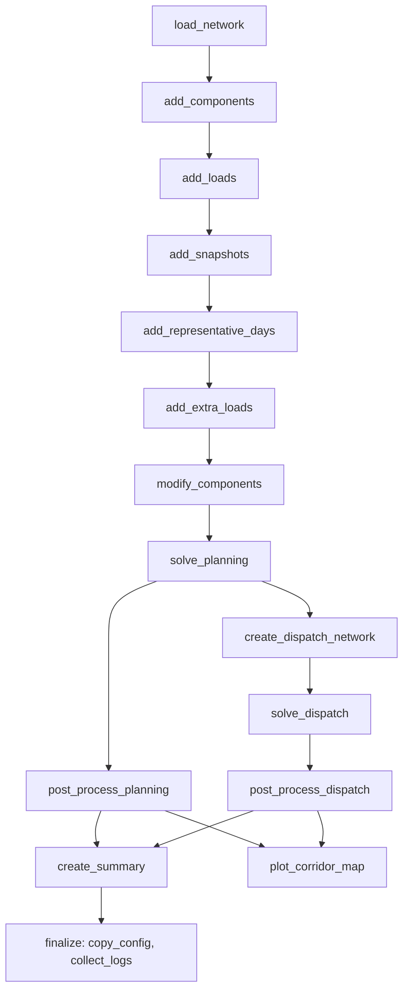

# Workflow Engine Overview

The workflow engine is **Snakemake**. The project wraps it in a Python CLI so you run scenarios from your working directory while the Snakefile and scripts live inside the installed `pypsa_canada` package.

## Entry point

You invoke it with:

```bash
pypsa_canada run -f config/minimal_model.yaml
```

That maps to the `run` command in `pypsa_canada/cli/workflow.py`. It:

1. Uses your **current working directory** as the Snakemake workdir (where `data/`, `resources/`, `results/`, and `logs/` are created).
2. Loads the Snakefile from the package: `pypsa_canada/workflow/Snakefile`.
3. Passes your YAML as the Snakemake config via the Snakemake 8+ Python API (`SnakemakeApi`).
4. Builds a DAG and executes it, using all CPU cores by default.

Related commands:

- `pypsa_canada dag -f ...` — visualize the rule graph (needs Graphviz).
- `pypsa_canada clean` — remove run artifacts.
- `pypsa_canada generate-postprocess` / `export-idea` — run individual post-processing steps outside the full workflow.

## Configuration

Each run is driven by a YAML file (e.g. `example/config/minimal_model.yaml`). At startup the Snakefile merges that with `config/default_config.yaml` in your workdir so missing keys get defaults:

```python
# Merge config with defaults to ensure all required keys are present
config = merge_with_defaults(config)
```

Important config sections include:

- `input_data` — base PyPSA network path
- `run.name` — run identifier (used in output paths)
- `year_settings` — investment periods, discount rate
- `load`, `snapshots`, `components`, `solving` — model behavior and solver options
- `postprocess` — optional exports (e.g. IDEA format)

## Run-scoped directories

The Snakefile derives paths from `config["run"]["name"]` and a timestamp:

| Path | Purpose |
|------|---------|
| `resources/{run_name}/networks/` | Intermediate `.nc` network files between rules |
| `results/{run_name}/run_{timestamp}/` | Final outputs for this execution |
| `logs/{run_name}/` | Per-rule log files |

A timestamp sentinel file keeps a crashed/restarted run on the same timestamp until it succeeds or fails.

## Pipeline stages (the DAG)

Rules are included in order in the Snakefile. The default target is `rule all`, which builds everything in `get_all_targets()`.



### Phase 1 — Build the planning network

Sequential chain of Python scripts:

1. **load_network** — load base network from `input_data`
2. **add_components** — add generators, storage, links, costs, etc.
3. **add_loads** — only if `load_mode != "DEFAULT"`
4. **add_snapshots** — time index and load profiles
5. **add_representative_days** — temporal clustering (CARPE_DIEM, k-medoids, etc.)
6. **add_extra_loads** — additional load scenarios
7. **modify_components** — constraints, OBPS, carbon tax, custom modifications → `planning_base_network.nc`

Each rule reads the previous rule’s `.nc` output and writes a new one under `resources/{run_name}/networks/`.

### Phase 2 — Planning optimization

8. **solve_planning** — capacity expansion / investment optimization with PyPSA + Linopy → `results/.../planning_solved_network/`

### Phase 3 — Dispatch optimization

9. **create_dispatch_network** — build an operational network from planning results (full snapshots, fixed capacities)
10. **solve_dispatch** — unit commitment / dispatch solve → `results/.../dispatch_solved_network/`

### Phase 4 — Post-processing

11. **post_process_planning** / **post_process_dispatch** — CSV summaries, metrics
12. **plot_corridor_map** — corridor visualization
13. **create_summary** — combined `results_summary.csv`
14. **export_idea** — optional, if `postprocess.export_format: idea`
15. **finalize** — copy config, aggregate all rule logs into `run.log`

## How a rule works

Each `.smk` file defines one Snakemake rule with `input`, `output`, `log`, and `script`. Example:

```python
rule load_network:
    input:
        input_data=config["input_data"]
    output:
        planning_unsolved_network=f"{RUN_NET_DIR}/load_network.nc"
    log:
       f"{RUN_LOG_DIR}/load_network.log"
    script:
        f"../scripts/load_network.py"
```

Snakemake runs the Python script and injects a global `snakemake` object with `input`, `output`, `config`, and `log`. Scripts typically:

- Load a PyPSA `Network` from the input `.nc`
- Apply transformations based on `snakemake.config`
- Export the updated network to the output path

Snakemake decides what to run from file timestamps and dependencies. If an intermediate `.nc` is up to date, that rule is skipped.

## Execution options

| Flag | Effect |
|------|--------|
| `--unlock` | Clear Snakemake lock after a crash (no execution) |
| `--keep-network` | `forceall=False` — only rerun changed rules |
| `--test` | Sets `PYPSA_TEST_MODE=1` for a short solve |
| `-t` / `--targets` | Run only specific rules |
| `-c` / `--cores` | Parallelism |
| `--verbose` | Show shell commands and job details |

By default, `forceall=True` (unless `--keep-network`), so a normal run rebuilds the full pipeline.

## Error handling

`finalize.smk` defines `onerror` and `onsuccess` handlers. On failure, the run output directory is moved to `results/{run_name}/crash_{timestamp}/` and logs, config, and network artifacts are collected for debugging.

## Summary

You point the CLI at a YAML config from a project directory (e.g. `example/`). Snakemake orchestrates a fixed DAG of Python scripts that progressively build a PyPSA network, solve planning then dispatch, post-process results, and write everything under `resources/`, `results/`, and `logs/` keyed by run name and timestamp.
